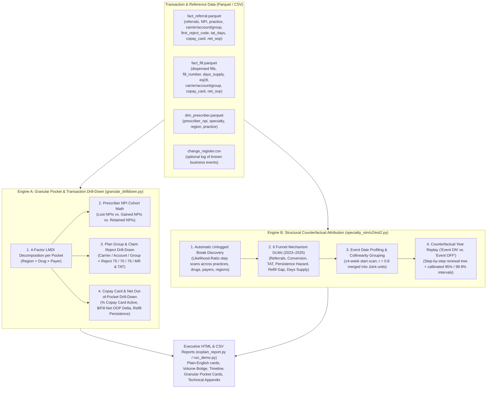

# How the Code Works: Specialty Pharmacy Volume Attribution & Granular Pocket Drill-Down

This document explains the end-to-end architecture, mathematics, and file-by-file implementation of the **Log Decomp Explainer** project.

---

## 1. The Core Problem This Code Solves

When specialty pharmacy volume changes between two periods (e.g., **2024 vs. 2025**), leadership asks two distinct questions:

1. **Where did volume move, and through which operational mechanism?**
   - Example: *"In the West region on Dupixent under Keystone Rx, we lost `-490 eq28` fills because Reject 75 (Prior Authorization Required) spiked on Carrier/Account/Group `CAR-KSRX / ACC-100 / GRP-ABC1234`, we net lost 75 prescribing NPIs while only gaining 30 lower-volume NPIs, and patients lost copay-card access so their net out-of-pocket jumped `+$50/fill`."*
2. **How much of the full-year volume change is attributable to each specific business event or shock?**
   - Example: *"How many 28-day-equivalent fills (`eq28`) did the Harbor Medicaid 90-day supply mandate add across 2025, vs. the Lakeside Dermatology practice loss, vs. the Dupixent copay-card restriction, vs. underlying baseline growth?"*

To answer both questions accurately—**even when the business change log is incomplete or missing**—this codebase combines **two complementary engines**:



---

## 2. Repository Map

| File | Role |
|---|---|
| [run_demo.py](file:///g:/My%20Drive/Log%20Decomp%20Explainer/run_demo.py) | **Main CLI entry point.** Runs `sample` (bundled sample world), `world --seed <N>` (simulates and explains a new world), or `batch` (multi-world scorecard). |
| [explain_report.py](file:///g:/My%20Drive/Log%20Decomp%20Explainer/explain_report.py) | **Executive HTML & chart generator.** Translates model outputs and pocket drill-downs into plain-English cards, the 2024 $\rightarrow$ 2025 volume bridge (`bridge.png`), and the monthly timeline (`monthly.png`). |
| [granular_drilldown.py](file:///g:/My%20Drive/Log%20Decomp%20Explainer/granular_drilldown.py) | **No-change-log pocket analyzer.** Decomposes every `Region × Drug × Payer` pocket via LMDI and drills into prescriber NPI churn, `carrier_id / account_id / group_id` Reject 75 spikes, and copay card / net OOP shifts. |
| [specialty_sim/v2/est2.py](file:///g:/My%20Drive/Log%20Decomp%20Explainer/specialty_sim/v2/est2.py) | **Core v2 counterfactual estimator.** Custom IRLS GLM solver, event timing profiler, residual break discovery, and step-by-step renewal volume simulator. |
| [specialty_sim/v2/sim2.py](file:///g:/My%20Drive/Log%20Decomp%20Explainer/specialty_sim/v2/sim2.py) | **Synthetic specialty pharmacy simulator (v2).** Generates 2020–2025 referrals, claims/rejects, plan groups (`GRP-ABC1234`, etc.), copay cards, net OOP, fills, and exact counterfactual ground truth using common random numbers. |
| [specialty_sim/v2/exec_report.py](file:///g:/My%20Drive/Log%20Decomp%20Explainer/specialty_sim/v2/exec_report.py) | **Evidence tiering & shared ranking logic.** Assigns `Confirmed` (99.9%), `Probable` (95%), `Joint`, `Not distinguishable`, `Unexplained driver`, and `Residual`. |
| [specialty_sim/v2/score.py](file:///g:/My%20Drive/Log%20Decomp%20Explainer/specialty_sim/v2/score.py) | **Calibration & evaluation harness.** Computes per-channel interval inflation factors ($k$) on calibration worlds and scores accuracy, coverage, direction errors, and ranking flips. |
| [specialty_sim/src/](file:///g:/My%20Drive/Log%20Decomp%20Explainer/specialty_sim/src/) | **v1 baseline & NCPDP message kit.** Includes `render_ncpdp.py` and `parse_ncpdp.py` for round-trip SCRIPT `NewRx`, `ePA`, and Telecom `D.0` B1/B2 claim messages. |

---

## 3. Standard Volume Measure: Why `eq28` (28-Day Equivalents)?

Raw unit counts cannot be summed across specialty drugs (e.g., 60 Otezla tablets vs. 1 Skyrizi pen), and raw fill counts distort the picture whenever a payer mandates 90-day refills (cutting fill counts by two-thirds while dispensing the exact same amount of therapy).

Every fill in `fact_fill` is therefore normalized to **28-day equivalents (`eq28`)**:
$$\text{eq28} = \frac{\text{days\_supply}}{28}$$
A 28-day fill equals `1.0 eq28`; an 84-day (3-month) fill equals `3.0 eq28`.

---

## 4. Engine A: How the Granular Pocket & Transaction Drill-Down Works (`granular_drilldown.py`)

This engine requires **zero change register**. It reads `fact_referral.parquet` and `fact_fill.parquet` directly and explains where and why volume moved at transaction grain.

### Step 1: 4-Factor LMDI Decomposition per `Region × Drug × Payer` Pocket
For every combination of `(region, drug, payer)`, total volume $V$ (`eq28`) in a year satisfies the multiplicative funnel identity:
$$V = R \times \underbrace{\left(\frac{S}{R}\right)}_{\text{Conversion } C} \times \underbrace{\left(\frac{F}{S}\right)}_{\text{Fills per Start } P} \times \underbrace{\left(\frac{V}{F}\right)}_{\text{eq28 per Fill } D}$$
where:
- $R$ = total referrals received in that pocket
- $S$ = converted referrals (new patient starts, `fill_number == 0`)
- $F$ = total dispensed fills (new starts + refills)
- $V$ = total `eq28` volume dispensed

Using the **Logarithmic Mean Divisia Index (LMDI-I)** with logarithmic mean $L(V_{24}, V_{25}) = \frac{V_{25} - V_{24}}{\ln V_{25} - \ln V_{24}}$, the exact volume change $\Delta V = V_{25} - V_{24}$ in every pocket splits additively into four funnel bars with zero residual:
$$\Delta V = \underbrace{L \ln\left(\frac{R_{25}}{R_{24}}\right)}_{\Delta \text{Referrals}} + \underbrace{L \ln\left(\frac{C_{25}}{C_{24}}\right)}_{\Delta \text{Conversion}} + \underbrace{L \ln\left(\frac{P_{25}}{P_{24}}\right)}_{\Delta \text{Retention / Refills}} + \underbrace{L \ln\left(\frac{D_{25}}{D_{24}}\right)}_{\Delta \text{Days Supply}}$$

### Step 2: Prescriber NPI Cohort Math (Inside $\Delta \text{Referrals}$)
To explain *why* referrals changed in a pocket, `analyze_pockets()` partitions every `prescriber_npi` active in that pocket across 2024 ($\mathcal{N}_{24}$) and 2025 ($\mathcal{N}_{25}$) into three mutually exclusive cohorts:
1. **Lost Prescribers ($\mathcal{N}_{24} \setminus \mathcal{N}_{25}$):** Doctors who sent referrals in 2024 but sent `0` in 2025. We report the exact NPI count, total lost referrals, and their **2024 average referrals per NPI**.
2. **Gained Prescribers ($\mathcal{N}_{25} \setminus \mathcal{N}_{24}$):** New doctors who sent `0` in 2024 and started prescribing in 2025. We report the gained NPI count, total new referrals, and their **2025 average referrals per NPI**.
   - *Why this matters:* Even if you gain 30 doctors and lose 75, comparing their average Rx/NPI immediately reveals when new prescribers are lower-volume than the established prescribers you lost.
3. **Retained Prescribers ($\mathcal{N}_{24} \cap \mathcal{N}_{25}$):** Same-store prescribers active in both years, plus the specific clinic/practice (`practice`) with the largest drop.

### Step 3: Carrier / Account / Group & Reject Code 75 Drill-Down (Inside $\Delta \text{Conversion}$)
Inside each pocket, referrals are grouped by plan hierarchy (`carrier_id / account_id / group_id`, e.g., `CAR-KSRX / ACC-100 / GRP-ABC1234`) to measure:
- **Reject 75 rate (`first_reject_code == "75"`):** Share of intake test claims hitting *Prior Authorization Required*.
- **Formulary / Plan Limit rejects (`"70"`, `"MR"`, `"76"`):** Share hitting *NDC Not Covered* or *Plan Limitations Exceeded*.
- **Turnaround time (`tat_days`):** Average days from referral receipt to first fill (longer TAT drives patient abandonment before Fill 0).
- **Plan-level conversion rate:** Identifies the exact employer group (`GRP-ABC1234`) responsible for the pocket's conversion drop.

### Step 4: Copay Card Coverage & Net Out-of-Pocket Drill-Down (Inside $\Delta \text{Conversion}$ and $\Delta \text{Retention}$)
For every referral and fill, the dataset tracks:
- `gross_oop`: Patient out-of-pocket responsibility before secondary assistance.
- `copay_card_used` (`0` or `1`) and `copay_assistance_amt`: Secondary payment from a manufacturer copay card.
- `net_oop = gross_oop - copay_assistance_amt`: Actual dollar amount the patient has to pay per fill.

When a plan adopts a copay accumulator or restricts copay card eligibility (`copay_shock`), `copay_card_used` drops (e.g., `78% → 14%`) and `net_oop` jumps by **`+$50/fill`** (e.g., `$15 → $65/fill`). The drill-down reports both the drop in first-fill conversion (sticker-shock abandonment) and the drop in fills-per-start (patients quitting mid-year when every refill costs $50 more).

---

## 5. Engine B: How the Structural Counterfactual Estimator Works (`specialty_sim/v2/est2.py`)

While Engine A tells you what happened inside individual slices, Engine B answers: **"Across the entire pharmacy, how many total 2025 `eq28` fills did each event cause, with a calibrated 95% confidence interval?"**

### Step 1: Custom IRLS GLM Solver (`glm()`)
To avoid memory overhead and fit hundreds of profiling models rapidly, `est2.py` (lines 49–96) implements its own **Iteratively Reweighted Least Squares (IRLS)** solver supporting three exponential-family links:
- **`poisson` (log link):** $\mu = \exp(\eta)$, used for monthly referral cell counts and refill gap days.
- **`logit` (logistic link):** $\mu = \frac{1}{1 + \exp(-\eta)}$, used for referral-level conversion probability.
- **`cloglog` (complementary log-log link):** $\mu = 1 - \exp(-\exp(\eta))$, used for discrete-time post-fill discontinuation hazard with offset $\ln(\text{days\_supply}/28)$.

### Step 2: Molecule-Family Grouping for Biosimilars
If a biosimilar launches mid-period (e.g., `Ustekinumab biosimilar` substituting for `Stelara`), decomposing at the individual NDC/drug level makes the switch look like a massive loss on Stelara and a massive gain on the biosimilar (a 2x overstatement).
In `Estimator.__init__` (lines 176–183), any originator and newly launched biosimilar in `sim2.BIOSIM_OF` are automatically merged into a single **molecule family** (`ustekinumab`, `etanercept`) so internal switching nets out and only true net leakage to competitors is attributed.

### Step 3: Automatic Discovery of Unlogged Breaks (`discover()`)
Before finalizing the models, `Estimator.discover()` (lines 271–333) compares observed monthly counts $O_m$ against model-expected counts $E_m$ across every **practice**, **drug**, **payer**, and **region** for every candidate break month in 2025.
It computes the Poisson **Likelihood Ratio (LR)** statistic for a step change at month $s$:
$$\text{LR}(s) = 2 \left[ \ell(O_{\text{pre}}, E_{\text{pre}}, \hat{r}_{\text{pre}}) + \ell(O_{\text{post}}, E_{\text{post}}, \hat{r}_{\text{post}}) - \ell(O, E, \hat{r}_0) \right]$$
where $\ell(O, E, r) = O \ln r - r E$. Any unlogged break with $\text{LR} > 30$ and a material relative shift ($\ge 30\%$ at practice level or $\ge 10\%$ at region/payer/drug level) is promoted to a discovered event (`U01`, `U02`, ...), added as a regressor so it cannot contaminate other events, and surfaced in the executive report as **`Not in change log: investigate`**.

### Step 4: The 6 Funnel Mechanism Models & Date Profiling
1. **`fit_referrals()`:** Fits the cell-month Poisson GLM with drug, payer, region, payer×region, drug×region, month-of-year seasonality, secular time trend $t$, and active referral event exposures.
2. **`fit_conversion()`:** Fits the referral-level logistic regression for conversion (`converted ~ payer + drug + region + source + month + t + events`) plus an OLS model for turnaround time (`tat_days`).
3. **`fit_persistence()`:** Fits the fill-level `cloglog` discontinuation hazard model (`lapse` defined as no refill within `days_supply + 60` days), a Poisson model for late refill gap days (`gap`), and tracks the observed monthly share of 90-day ($3\times$) refills by payer (`self.q`).
4. **Date & Ramp Profiling:** Because business logs often have start dates off by a few weeks, the estimator scans shifts of `[-28, -14, 0, +14, +28]` days and ramp durations of `[0, 45, 90]` days, accepting a corrected start date if it improves log-likelihood by more than `PROFILE_MARGIN = 3.0`.

### Step 5: Step-by-Step Counterfactual Renewal Simulation (`step_renewal()` & `attribute()`)
To convert model coefficients into full-year 2025 `eq28` volume impact, `attribute()` (lines 595–774) computes expected 2025 volume under **All Events ON** vs. **Event $E$ Switched OFF**:
- For each cohort of referrals or active patients starting at day $t_0$, `step_renewal()` steps forward fill by fill ($k = 0, 1, 2, \dots$) through December 31, 2025 (`END_D`):
  - At each fill date $t_k$, survival to the next fill is multiplied by $\exp(-\lambda(t_k) \cdot \text{ds}_k)$, where $\lambda(t_k) = \exp(\eta_h(t_k))/28$ is the daily discontinuation hazard.
  - The next fill date is $t_{k+1} = t_k + \text{ds}_k + g(t_k)$, where $g(t_k) = \exp(\eta_g(t_k))$ is the expected refill gap.
  - Expected `eq28` dispensed in 2025 is accumulated over all fills with $t_k \le \text{Dec 31, 2025}$.
- The volume impact of Event $E$ is:
  $$\widehat{\Delta V}_E = \sum \text{eq28}(\text{All Events ON}) - \sum \text{eq28}(\text{Event } E \text{ OFF})$$
- Uncertainty is computed by drawing 300 parameter vectors from the GLM covariance matrices (`multivariate_normal`), adding binomial/Poisson process variance (`var_proc`), and scaling by the frozen per-channel calibration factor $k_{\text{channel}}$ from `specialty_sim/v2/results/calibration_factors.csv`.

---

## 6. How to Run the Pipeline

```powershell
$py = "$env:USERPROFILE\.venvs\log-decomp-explainer\Scripts\python.exe"

# 1. Run on the bundled sample world (~2 min)
& $py run_demo.py sample

# 2. Simulate a brand-new world (with Carrier/Account/Group + Copay/OOP shock) and explain it (~3 min)
& $py run_demo.py world --seed 2005

# 3. Run a multi-world batch and score against the answer key
& $py run_demo.py batch --start 1061 --end 1064 --procs 2
```

Every run writes `report.html`, `exec_report.csv`, `granular_pocket_drilldown.csv`, `bridge.png`, and `monthly.png` inside `runs/<world_name>/`.
